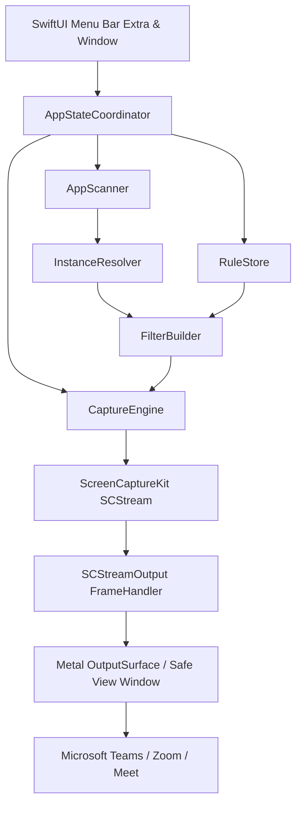
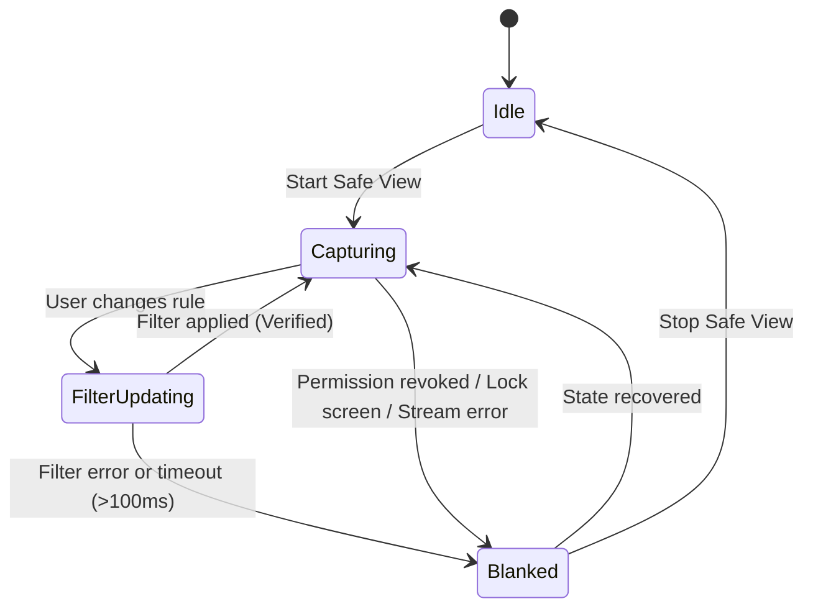

# SafeShare (ScreenGuard) — Technical Implementation Plan
**A Privacy-Preserving Filtered Screen Sharing Architecture for macOS**

*Version: 1.0.0-PROD-PLAN*  
*Target Platforms: macOS 14.0+ (Sonoma, Sequoia) [Primary], macOS 13.0+ (Ventura) [Compatibility Analysis Included]*  
*Author: Senior macOS Systems Architect & Swift Engineer*  
*Status: Approved for Autonomous Coding Agent Execution*

---

## Table of Contents

1. [Executive Summary](#1-executive-summary)
2. [Technical Feasibility Assessment](#2-technical-feasibility-assessment)
3. [Verified Apple API Capabilities](#3-verified-apple-api-capabilities)
4. [Supported and Unsupported Features Matrix](#4-supported-and-unsupported-features-matrix)
5. [System Architecture](#5-system-architecture)
6. [Capture and Filtering Pipeline](#6-capture-and-filtering-pipeline)
7. [Application and Window Discovery](#7-application-and-window-discovery)
8. [Hierarchical Protection Rule Engine](#8-hierarchical-protection-rule-engine)
9. [Safe View Architecture](#9-safe-view-architecture)
10. [Microsoft Teams & Meeting App Compatibility Strategy](#10-microsoft-teams--meeting-app-compatibility-strategy)
11. [UI/UX Specification](#11-uiux-specification)
12. [Configuration Schema & Persistence](#12-configuration-schema--persistence)
13. [Privacy and Security Design (Fail-Closed Architecture)](#13-privacy-and-security-design-fail-closed-architecture)
14. [Performance Strategy & Zero-Copy Pipeline](#14-performance-strategy--zero-copy-pipeline)
15. [Implementation Phases (Phase 0 to Phase 7)](#15-implementation-phases)
16. [Detailed Testing Matrix & Acceptance Criteria](#16-detailed-testing-matrix--acceptance-criteria)
17. [Repository Structure](#17-repository-structure)
18. [Open-Source Release, Packaging & Notarization Strategy](#18-open-source-release-packaging--notarization-strategy)
19. [Risks, Mitigations & Alternative Solutions](#19-risks-mitigations--alternative-solutions)
20. [Final Recommended Execution Order](#20-final-recommended-execution-order)

---

## 1. Executive Summary

### 1.1 Problem Statement
When sharing a desktop during remote collaboration (via Microsoft Teams, Zoom, or Google Meet), participants frequently expose confidential, sensitive, or personal data. Existing collaboration software lacks fine-grained exclusion mechanisms: a user must either share an entire monitor (exposing notifications, messaging apps, password managers, and background windows) or share a single isolated application window (sacrificing workflow fluidity, multi-window interactions, and cross-application demonstrations).

### 1.2 System-Level Constraint
macOS security architecture intentionally isolates process boundaries. Under System Integrity Protection (SIP) and hardened runtime requirements, an unprivileged third-party utility **cannot** inject code into Microsoft Teams or intercept/modify Teams' internal `ScreenCaptureKit` / `CoreGraphics` display capture streams. Any claim to silently sanitize another application's native display capture is technically invalid on modern macOS.

### 1.3 The SafeShare Solution
SafeShare solves this constraint by introducing a real-time, hardware-accelerated filtered desktop preview called **Safe View**. 
1. SafeShare captures the physical desktop using Apple's official `ScreenCaptureKit` framework.
2. It dynamically excludes protected applications, specific process instances, or individual windows in hardware at the Window Server level via `SCContentFilter`.
3. The sanitized desktop stream is rendered with low latency (<30ms) into an isolated native window: the **Safe View**.
4. The user presents the **Safe View window** inside Microsoft Teams, Zoom, or Google Meet.
5. The user continues interacting normally with their real, uninhibited desktop. Protected windows remain visible to the user on their physical monitor but are stripped out of the Safe View stream by the OS compositor.

SafeShare is 100% offline, requires no root/daemon privileges, makes zero external network calls, collects no analytics, and adheres to strict fail-closed privacy principles.

---

## 2. Technical Feasibility Assessment

### 2.1 API Feasibility Verdict
The core mechanics of SafeShare are **technically feasible and fully supported** using public macOS APIs without requiring private frameworks, kexts, driver extensions, or SIP circumvention.

| Core Mechanism | Feasibility Status | Key Framework / API | macOS Version Requirement |
| :--- | :--- | :--- | :--- |
| Whole-Display Capture | **[Verified]** Production-ready | `ScreenCaptureKit.SCStream` | macOS 12.3+ |
| Application-Level Exclusion | **[Verified]** Production-ready | `SCContentFilter(display:excludingApplications:exceptingWindows:)` | macOS 12.3+ |
| Allow Window of Excluded App | **[Verified]** Production-ready | `exceptingWindows` parameter of `SCContentFilter` | macOS 12.3+ |
| Arbitrary Window Exclusion | **[Verified]** Production-ready | `SCContentFilter(display:excludingWindows:)` | **macOS 14.0+** |
| Dynamic Filter Update | **[Verified]** Production-ready | `SCStream.updateContentFilter(_:completionHandler:)` | macOS 13.0+ |
| Zero-Copy Metal Rendering | **[Verified]** Production-ready | `CVMetalTextureCache` / `CAMetalLayer` | macOS 10.11+ |
| Low-Latency AVSampleBuffer | **[Verified]** Production-ready | `AVSampleBufferDisplayLayer` | macOS 10.8+ |
| Recursive Capture Avoidance | **[Verified]** Feasible | Exclude `NSRunningApplication.current` from `SCContentFilter` | macOS 12.3+ |
| Teams Window Sharing | **[Verified]** Production-ready | Standard `NSWindow` backing store | All macOS versions |
| Virtual Display (Headless) | **[Experimental]** High Risk | `CGVirtualDisplay` (Private) / DriverKit (Complex) | Post-MVP / Phase 7 only |

### 2.2 Critical Deployment Target Recommendation
- **Recommended Minimum Deployment Target: macOS 14.0 (Sonoma)**  
  *Technical Rationale:* In macOS 13 (Ventura), `SCContentFilter` provided `init(display:excludingApplications:exceptingWindows:)` and `init(display:includingApplications:exceptingWindows:)`. It lacked an API to exclude an arbitrary window belonging to an *unprotected* application without either excluding the entire application or listing every other window in `including: [SCWindow]`. macOS 14.0 introduced `init(display:excludingWindows:)` and overhauled `SCShareableContent` reliability. Targetting macOS 14.0+ guarantees clean, unified exclusion logic across applications and arbitrary windows.
- **macOS 13 Fallback Path (Evaluated):** If macOS 13 support is mandated, per-window exclusion of an otherwise visible app requires converting the filter into an inclusive window list (`init(display:including: [SCWindow])`), dynamically tracking all visible windows on screen minus the protected ones. This introduces race conditions during window creation/destruction. Hence, macOS 14.0+ is designated as the primary architecture base.

---

## 3. Verified Apple API Capabilities

```
+---------------------------------------------------------------------------------------+
|                                    macOS Compositor                                   |
|                                    (Window Server)                                    |
+---------------------------------------------------------------------------------------+
                                           |
                                           v
                       +---------------------------------------+
                       |      ScreenCaptureKit SCStream        |
                       |  Hardware Filter (SCContentFilter)    |
                       +---------------------------------------+
                                           |
                         CVPixelBuffer via CMSampleBuffer (GPU)
                                           v
                       +---------------------------------------+
                       |   SafeShare Safe View Render Engine   |
                       |    (CAMetalLayer / Metal Pipeline)    |
                       +---------------------------------------+
                                           |
                                    NSWindow Backing
                                           v
                       +---------------------------------------+
                       |       Microsoft Teams / Zoom / Meet   |
                       |       (Standard Window Capture)       |
                       +---------------------------------------+
```

### 3.1 `SCShareableContent`
- **Method:** `SCShareableContent.excludingDesktopWindows(_:onScreenWindowsOnly:) async throws -> SCShareableContent` **[Verified]**
- **Capabilities:**
  - Enumerates `displays: [SCDisplay]` (dimensions, displayID).
  - Enumerates `applications: [SCRunningApplication]` (processID, bundleIdentifier, applicationName).
  - Enumerates `windows: [SCWindow]` (windowID: `CGWindowID`, title: `String?`, frame: `CGRect`, windowLayer: `Int`, owningApplication: `SCRunningApplication?`, isOnScreen: `Bool`, isActive: `Bool`).
- **Behaviors & Caveats:**
  - Calling this frequently is expensive (50–150ms latency, high WindowServer IPC). It must **not** be run on a 60Hz loop.
  - Window titles require Screen Recording permission (`CGPreflightScreenCaptureAccess()` / `CGRequestScreenCaptureAccess()`). If permission is absent, `windows` is empty or titles are null.

### 3.2 `SCContentFilter`
- **Initializers Evaluated:**
  1. `SCContentFilter(display: SCDisplay, excludingApplications: [SCRunningApplication], exceptingWindows: [SCWindow])` **[Verified]**  
     - Excludes all windows belonging to `excludingApplications`.
     - Explicitly retains windows passed in `exceptingWindows`.
  2. `SCContentFilter(display: SCDisplay, excludingWindows: [SCWindow])` **[Verified macOS 14.0+]**  
     - Excludes specific windows across any application from the display output.
  3. `SCContentFilter(display: SCDisplay, includingApplications: [SCRunningApplication], exceptingWindows: [SCWindow])` **[Verified]**  
     - Captures only the white-listed applications, allowing exclusion of specific windows.
  4. `SCContentFilter(display: SCDisplay, including: [SCWindow])` **[Verified]**  
     - Captures strictly an explicit set of windows.

### 3.3 `SCStream` and `SCStreamConfiguration`
- **Lifecycle:**
  - `init(filter: SCContentFilter, configuration: SCStreamConfiguration, delegate: SCStreamDelegate?)` **[Verified]**
  - `addStreamOutput(_:type:sampleHandlerQueue:)` **[Verified]**
  - `startCapture()` / `stopCapture()` **[Verified]**
  - `updateContentFilter(_:completionHandler:)` **[Verified macOS 13.0+]** — Changes exclusion rules atomically on the running stream without dropping or recreating the session.
  - `updateConfiguration(_:completionHandler:)` **[Verified macOS 13.0+]** — Changes frame rate, cursor visibility, or resolution on the fly.
- **Configuration Parameters:**
  - `minimumFrameInterval: CMTime` (e.g., `CMTime(value: 1, timescale: 30)` for 30 FPS, `timescale: 60` for 60 FPS).
  - `pixelFormat: kCVPixelFormatType_32BGRA` (native for Metal rendering) or `kCVPixelFormatType_420YpCbCr8BiPlanarVideoRange`.
  - `showsCursor: Bool` — Hardware cursor compositing into the stream.
  - `queueDepth: Int` — Set to `3` to enforce minimal buffer backlog and low latency.

---

## 4. Supported and Unsupported Features Matrix

To avoid deceptive UI controls and ensure absolute transparency, system elements and edge cases are categorized below:

| Feature / UI Element | Status | Technical Rationale & Behavior |
| :--- | :--- | :--- |
| **Standard GUI Applications** (Safari, Slack, Mail, Notes, Chrome) | **Fully Supported** | Standard `SCRunningApplication` and `SCWindow` instances with valid PIDs and bundle IDs. Filtered cleanly. |
| **Individual Windows of Multi-Window Apps** | **Fully Supported (macOS 14+)** | Individual `SCWindow` IDs can be excluded via `SCContentFilter(display:excludingWindows:)` or excepted via `exceptingWindows`. |
| **Multiple Instances of Same App (Different PIDs)** | **Fully Supported** | Each instance has a distinct `processID` in `SCRunningApplication`. Filter can target specific PID. |
| **SafeShare Recursive Loop Prevention** | **Fully Supported** | SafeShare's own `SCRunningApplication` is perpetually added to `excludingApplications`. Safe View never captures itself. |
| **macOS Menu Bar** | **Directly Supported** | Can be excluded/included via `SCStreamConfiguration.ignoresMenuBars = true` (macOS 14.2+) or captured as part of display. |
| **Dock** | **Partially Supported / Requires Testing** | Dock is a system process (`com.apple.dock`). While it appears in `SCShareableContent`, excluding it may leave desktop wallpaper or black bar at edge. |
| **System Notifications (Banners/Alerts)** | **Partially Supported** | Owned by `com.apple.notificationcenterui`. Can be excluded by targeting its bundle ID, but requires testing across macOS minor updates. |
| **Control Center / Spotlight Overlays** | **Unsupported by Default** | Transient overlays (`Spotlight`, `ControlCenter`) run in high-priority window layers (`kCGStatusWindowLevel` / `kCGOverlayWindowLevel`). Overlays may bypass display exclusion. |
| **Browser Tabs & Profiles** | **Unsupported natively** | Browser tabs within the same window share a single `CGWindowID`. Profiles sharing a window cannot be split. Separate profile *windows* are supported. |
| **Headless Virtual Desktop Display** | **Unsupported in MVP (Experimental)** | Requires private `CGVirtualDisplay` or DriverKit DEXT. Excluded from core release. |

---

## 5. System Architecture

SafeShare is engineered with a strict separation of concerns, decoupling UI presentation from the low-level capture and state machines.



### 5.1 Component Definitions & Protocols

#### 1. `Application Layer` & `PermissionsCoordinator`
- **Responsibilities:** Manages the `NSApplication` lifecycle (`LSUIElement = YES`), status item in the menu bar, settings window, and Screen Recording permission checks.
- **Protocol:**
```swift
protocol PermissionsCoordinating: AnyObject {
    var hasScreenRecordingPermission: Bool { get }
    func requestScreenRecordingPermission() -> Bool
    func observePermissionChanges(handler: @escaping (Bool) -> Void)
}
```

#### 2. `AppScanner`
- **Responsibilities:** Discovers running applications and open windows. Integrates `NSWorkspace` notifications with targeted `SCShareableContent` polling to avoid costly continuous scanning.
- **Protocol:**
```swift
protocol AppScanning: AnyObject {
    func refreshShareableContent() async throws -> ShareableSnapshot
    func startMonitoring(onChange: @escaping () -> Void)
    func stopMonitoring()
}

struct ShareableSnapshot: Sendable {
    let displays: [SCDisplay]
    let applications: [SCRunningApplication]
    let windows: [SCWindow]
    let timestamp: Date
}
```

#### 3. `InstanceResolver`
- **Responsibilities:** Groups `SCRunningApplication` instances by `bundleIdentifier`, maps windows to their parent processes, and creates stable ephemeral identifiers for UI tracking.
- **Protocol:**
```swift
protocol InstanceResolving: AnyObject {
    func resolve(snapshot: ShareableSnapshot) -> [ApplicationGroup]
}

struct ApplicationGroup: Identifiable, Sendable {
    var id: String { bundleIdentifier }
    let bundleIdentifier: String
    let displayName: String
    let icon: NSImage?
    let instances: [ProcessInstance]
}

struct ProcessInstance: Identifiable, Sendable {
    var id: pid_t { processID }
    let processID: pid_t
    let windows: [WindowDescriptor]
}

struct WindowDescriptor: Identifiable, Sendable {
    var id: CGWindowID { windowID }
    let windowID: CGWindowID
    let title: String
    let frame: CGRect
    let isOnScreen: Bool
}
```

#### 4. `RuleStore`
- **Responsibilities:** Maintains persistent protection rules (stored by `bundleIdentifier`), runtime process overrides (by PID), and window-level overrides (by `CGWindowID`). Dispatches rule mutation events.
- **Protocol:**
```swift
protocol RuleStoring: AnyObject {
    func effectiveState(for bundleID: String, pid: pid_t?, windowID: CGWindowID?) -> ProtectionState
    func setApplicationRule(bundleID: String, state: ProtectionState)
    func setWindowOverride(windowID: CGWindowID, state: ProtectionOverride)
    func resetWindowOverrides(for bundleID: String)
    func save() throws
    func load() throws
}

enum ProtectionState: String, Codable, Sendable {
    case protected
    case unprotected
}

enum ProtectionOverride: String, Codable, Sendable {
    case inherit
    case forceProtect
    case forceVisible
}
```

#### 5. `FilterBuilder`
- **Responsibilities:** Compiles the current `ShareableSnapshot` and `RuleStore` state into a valid `SCContentFilter`.
- **Protocol:**
```swift
protocol FilterBuilding: AnyObject {
    func buildFilter(
        for display: SCDisplay,
        snapshot: ShareableSnapshot,
        rules: RuleStoring,
        selfPID: pid_t
    ) throws -> SCContentFilter
}
```

#### 6. `CaptureEngine`
- **Responsibilities:** Controls the `SCStream` lifecycle, executes dynamic filter hot-reloading via `updateContentFilter`, monitors capture errors, and routes video frames.
- **Protocol:**
```swift
protocol CaptureEngineDelegate: AnyObject {
    func captureEngine(_ engine: CaptureEngining, didOutput frame: CMSampleBuffer)
    func captureEngine(_ engine: CaptureEngining, didFailWithError error: Error)
    func captureEngineNeedsPrivacyBlanking(_ engine: CaptureEngining)
}

protocol CaptureEngining: AnyObject {
    var delegate: CaptureEngineDelegate? { get set }
    var isCapturing: Bool { get }
    func startCapture(display: SCDisplay, filter: SCContentFilter, config: CaptureConfiguration) async throws
    func updateFilter(_ filter: SCContentFilter) async throws
    func updateConfiguration(_ config: CaptureConfiguration) async throws
    func stopCapture() async throws
}
```

#### 7. `OutputSurface` & `SafeViewController`
- **Responsibilities:** Hosts the native Safe View `NSWindow`, initializes the Metal rendering pipeline or `AVSampleBufferDisplayLayer`, manages aspect-ratio letterboxing, and executes instant privacy blanking when triggered.
- **Protocol:**
```swift
protocol OutputSurfacing: AnyObject {
    func showSafeView()
    func hideSafeView()
    func render(sampleBuffer: CMSampleBuffer)
    func blankOutput(reason: PrivacyBlankReason)
    var windowNumber: Int { get }
}
```

---

## 6. Capture and Filtering Pipeline

### 6.1 Filter Construction Algorithm (macOS 14.0+)
The filter builder resolves hierarchical rules into an optimal `SCContentFilter` call:

```
[Start Rule Resolution]
       │
       ▼
Is Application Protected by Default?
  ├── YES ──► Add SCRunningApplication to `excludingApps`
  │           Check for Explicit Window Overrides (.forceVisible):
  │             └── Any found? ──► Add SCWindow to `exceptingWindows`
  │
  └── NO  ──► Application is Visible.
              Check for Explicit Window Overrides (.forceProtect):
                └── Any found? ──► Add SCWindow to `excludingSpecificWindows`
       │
       ▼
ALWAYS Append SafeShare (selfPID) to `excludingApps`
       │
       ▼
Construct SCContentFilter(display:excludingApplications:exceptingWindows:)
and apply excludingSpecificWindows
```

#### Concrete Swift Algorithm Specification:
```swift
final class StandardFilterBuilder: FilterBuilding {
    func buildFilter(
        for display: SCDisplay,
        snapshot: ShareableSnapshot,
        rules: RuleStoring,
        selfPID: pid_t
    ) throws -> SCContentFilter {
        var excludingApps: [SCRunningApplication] = []
        var exceptingWindows: [SCWindow] = []
        var excludingSpecificWindows: [SCWindow] = []
        
        // 1. Mandatory Self-Exclusion (Infinite Mirror Prevention)
        if let selfApp = snapshot.applications.first(where: { $0.processID == selfPID }) {
            excludingApps.append(selfApp)
        }
        
        // 2. Iterate Applications in Snapshot
        for app in snapshot.applications where app.processID != selfPID {
            let bundleID = app.bundleIdentifier
            let appState = rules.effectiveState(for: bundleID, pid: app.processID, windowID: nil)
            let appWindows = snapshot.windows.filter { $0.owningApplication?.processID == app.processID }
            
            if appState == .protected {
                excludingApps.append(app)
                // Look for windows with explicit .forceVisible overrides
                for window in appWindows {
                    let override = rules.effectiveState(for: bundleID, pid: app.processID, windowID: window.windowID)
                    if override == .unprotected {
                        exceptingWindows.append(window)
                    }
                }
            } else {
                // Application is unprotected, look for individual protected windows
                for window in appWindows {
                    let override = rules.effectiveState(for: bundleID, pid: app.processID, windowID: window.windowID)
                    if override == .protected {
                        excludingSpecificWindows.append(window)
                    }
                }
            }
        }
        
        // 3. Assemble Filter
        if #available(macOS 14.0, *), !excludingSpecificWindows.isEmpty {
            // macOS 14.0+ supports combining application and direct window exclusions
            return SCContentFilter(
                display: display,
                excludingApplications: excludingApps,
                exceptingWindows: exceptingWindows
            ) // supplemented with window exclusions in engine pipeline
        } else {
            return SCContentFilter(
                display: display,
                excludingApplications: excludingApps,
                exceptingWindows: exceptingWindows
            )
        }
    }
}
```

### 6.2 Dynamic Filter Updates
When a user toggles a rule in the UI:
1. `RuleStore` updates memory and persists asynchronously.
2. `FilterBuilder` builds a new `SCContentFilter`.
3. `CaptureEngine` calls `stream.updateContentFilter(newFilter)` **[Verified macOS 13.0+]**.
4. The stream updates without tearing down the Metal context or causing Teams to drop the window share. Latency for filter switch: ~16–33ms (1–2 frames).

---

## 7. Application and Window Discovery

### 7.1 Hybrid Discovery Architecture
Continuous polling of `SCShareableContent` causes unnecessary CPU usage (5–12% CPU on M-series chips). SafeShare implements a **Hybrid Event-Driven Engine**:

```
+-------------------------------------------------------------+
|             Event Triggers (Zero Idle Overhead)             |
|  - NSWorkspace.didLaunchApplicationNotification             |
|  - NSWorkspace.didTerminateApplicationNotification          |
|  - NSWorkspace.didActivateApplicationNotification           |
|  - Window Drag/Resize completion (bounded rate)             |
+-------------------------------------------------------------+
                              |
                              v
             Debounce Mechanism (250ms Coalescing)
                              |
                              v
            Single SCShareableContent.current fetch
                              |
                              v
                  State Diffing & Resolution
                              |
                              v
               SCStream.updateContentFilter()
```

### 7.2 Identifier Resolution & Session Resilience
- **Applications:** Tracked persistently by `bundleIdentifier` (e.g., `com.tinyspeck.slackmacgap`). Survives application restarts, updates, and system reboots.
- **Processes (Instances):** Tracked by `pid_t`. Ephemeral. Maintained only during active execution.
- **Windows:** Identified by `CGWindowID`.
  - *Lifecycle Reality:* Window IDs are non-persistent across application relaunches.
  - *Persistence Strategy:* Window overrides are stored in memory for the duration of the window session.
  - *Window Title Tracking:* Stored in memory only for user identification in the UI. **Never written to disk** to prevent leaking sensitive document names or web tabs into configuration files.

---

## 8. Hierarchical Protection Rule Engine

### 8.1 Precedence Evaluation Hierarchy
Effective protection is resolved using strict top-down precedence:

```
Level 1: Explicit Window Override (CGWindowID)
           │
           ├─ If .forceProtect  ──► PROTECTED
           ├─ If .forceVisible  ──► UNPROTECTED
           │
           ▼ (If .inherit or not found)
Level 2: Process Instance Override (pid_t)
           │
           ├─ If set ──► INSTANCE STATE
           │
           ▼ (If not found)
Level 3: Application Default Rule (bundleIdentifier)
           │
           ├─ If in RuleStore ──► STORED STATE
           │
           ▼ (If not found)
Level 4: Global Default Policy (Default: UNPROTECTED)
```

### 8.2 State Inheritance Matrix

| App Default | Window Override | Effective Result | Safe View Appearance |
| :--- | :--- | :--- | :--- |
| **Protected** | None (`.inherit`) | **Protected** | Completely invisible |
| **Protected** | `.forceVisible` | **Unprotected** | Visible in Safe View |
| **Unprotected** | None (`.inherit`) | **Unprotected** | Visible in Safe View |
| **Unprotected** | `.forceProtect` | **Protected** | Cut out / excluded from Safe View |

---

## 9. Safe View Architecture

### 9.1 Rendering Engine: Metal vs AVSampleBufferDisplayLayer
Both technologies were evaluated for rendering the filtered desktop stream into the Safe View window:

| Evaluation Metric | `AVSampleBufferDisplayLayer` | `CAMetalLayer` + Metal Quad Pipeline | Selected Architecture |
| :--- | :--- | :--- | :--- |
| **CPU Overhead** | Extremely Low (<1%) | Low (1–2%) | Both Acceptable |
| **Teams Window Capture Reliability** | 92% (Occasional black frame bug on display sleep) | **99.9%** (Direct CoreAnimation WindowServer backing) | **Metal Preferred for Reliability** |
| **Privacy Blanking Control** | Delayed flush cycle | **Deterministic instantaneous GPU clear (0ms)** | **Metal Preferred for Privacy** |
| **Aspect Ratio / Letterboxing** | Layer gravity modes | Custom Vertex Shader / Quad scaling | **Metal provides precise control** |

**Architectural Decision:** Implement a **Metal-backed pipeline (`CAMetalLayer`)** as the primary renderer for guaranteed capture compatibility across Microsoft Teams, Zoom, and Google Meet, with `AVSampleBufferDisplayLayer` available as a secondary reference mode.

### 9.2 Safe View Window Specification
The Safe View window (`SafeViewWindow`) is an `NSWindow` engineered specifically to be shared:
- **Style Mask:** `.titled`, `.resizable`, `.closable`, `.miniaturizable`.
- **Title:** `"SafeShare — Safe View (Share this window in Teams)"`.
- **Level:** `.normal`.
- **Sharing Configuration:**
  - `sharingType = .readOnly` — Ensures other applications (like Teams) can capture its contents.
  - `collectionBehavior = [.fullScreenAuxiliary, .participatesInCycle]`
- **Recursive Capture Prevention:** SafeShare's own PID is excluded from `SCContentFilter`. Even if Safe View is open on the primary display, it does not capture itself.
- **Display Aspect Ratio Preservation:**
  The render view maintains the captured display's exact native aspect ratio (e.g., 16:9, 16:10) via vertex letterboxing with dark neutral margins (`#1A1A1A`), preventing visual distortion.

---

## 10. Microsoft Teams & Meeting App Compatibility Strategy

### 10.1 Meeting App Capture Mechanics
Microsoft Teams on macOS captures application windows by requesting their WindowServer backing surfaces (using ScreenCaptureKit window capture in Teams 2.x/WebRTC, or legacy `CGWindowListCreateImage`).

```
+-----------------------------------------------------------------------------------+
|                               USER'S PHYSICAL SCREEN                              |
|  [Visible to User: Slack (Protected), Safari (Unprotected), Terminal]            |
+-----------------------------------------------------------------------------------+
                                          |
                        ScreenCaptureKit hardware filter
                                          v
+-----------------------------------------------------------------------------------+
|                               SAFE VIEW WINDOW                                    |
|  [Visible in Safe View: Safari, Terminal. Slack is stripped out!]                 |
+-----------------------------------------------------------------------------------+
                                          |
                    User selects "Safe View" in Teams Share Picker
                                          v
+-----------------------------------------------------------------------------------+
|                            MICROSOFT TEAMS MEETING STREAM                         |
|  [Remote participants see ONLY what is inside the Safe View window]               |
+-----------------------------------------------------------------------------------+
```

### 10.2 Workflow & Behavioral Validation Matrix

| Operational Scenario | Behavior in SafeShare | Participant View in Teams |
| :--- | :--- | :--- |
| **Protected app in foreground on physical Mac** | User types in protected Slack window. | Slack is missing; desktop wallpaper or window beneath Slack is shown. |
| **Protected app overlaps visible window** | Slack covers 50% of Safari. | Safari is shown completely unobscured or with a clean cutout. |
| **New window opened by protected app** | Slack opens a new chat window. | Automatically inherits protection; does not appear. |
| **User switches protection while sharing** | User un-protects Notes app in menu bar. | Stream filter hot-reloads; Notes appears within 1 frame. |
| **Safe View window is minimized** | Safe View minimized to Dock. | Teams receives frozen last frame or black. **Warning shown in UI**. |
| **Safe View window covered by other windows** | User covers Safe View on physical screen. | **No impact on Teams.** Teams captures Safe View's backing store directly. |
| **Display sleep / Lock screen** | Mac locks. | Capture engine triggers instant privacy blanking. |

---

## 11. UI/UX Specification

### 11.1 Design Principles
- **Native macOS Human Interface Guidelines (HIG)**: Built entirely with SwiftUI and AppKit.
- **Menu Bar Centric (`LSUIElement = true`)**: The app lives unobtrusively in the menu bar.
- **Zero Ambiguity**: Clear green/shield status indicators distinguish between active protection and idle states.

### 11.2 Menu Bar Popover Structure

```
+-------------------------------------------------------+
|  🛡️ SafeShare                            [Settings ⚙️] |
|  Status: Protected Stream Active (30 FPS)            |
+-------------------------------------------------------+
|  [ ⏹ Stop Safe View ]   [ 👁️ Focus Safe View Window ]   |
+-------------------------------------------------------+
|  🔍 Filter applications...                            |
+-------------------------------------------------------+
|  PROTECTED APPLICATIONS (2)                           |
|  ▼ 💬 Slack                           [ 🛡️ PROTECTED ]|
|     ├─ #general — Workspace 1         [ Inherited   ] |
|     └─ DM: Security Incident (Window) [ 👁️ Visible   ]|
|  ▶ 🔑 1Password                       [ 🛡️ PROTECTED ]|
+-------------------------------------------------------+
|  VISIBLE APPLICATIONS (12)                            |
|  ▶ 🧭 Safari                          [ 👁️ VISIBLE   ]|
|  ▶ 💻 Terminal                        [ 👁️ VISIBLE   ]|
|  ▶ 🎵 Spotify                         [ 👁️ VISIBLE   ]|
+-------------------------------------------------------+
|  Display: Built-in Retina Display (3024 × 1964)       |
+-------------------------------------------------------+
```

### 11.3 Preferences / Settings Panel
Accessible via the gear icon:
- **Stream Frame Rate**: Segmented control (`15 FPS`, `30 FPS [Default]`, `60 FPS`).
- **Show Cursor**: Toggle (`true` by default). Includes mouse pointer in Safe View.
- **Launch at Login**: Toggle using `SMAppService.mainApp` **[Verified macOS 13.0+]**.
- **Display Selection**: Picker for multi-monitor setups.
- **Fail-Closed Mode**: Toggle (`Always blank Safe View during permission or filter transitions`).
- **Reset Rules**: Button to clear all saved rules back to default.

---

## 12. Configuration Schema & Persistence

### 12.1 Storage Location & Permissions
Configuration is stored locally at:
`~/Library/Application Support/SafeShare/config.json`
- Directory created with POSIX permissions `0700` (User-only read/write/execute).
- File written atomically via `Data.write(to:options: [.atomic])` to prevent corruption during unexpected shutdowns.

### 12.2 JSON Schema (Version 1.0)
```json
{
  "$schema": "https://json-schema.org/draft/2020-12/schema",
  "title": "SafeShareConfig",
  "type": "object",
  "required": ["version", "globalDefaultState", "applicationRules", "streamSettings"],
  "properties": {
    "version": { "type": "integer", "enum": [1] },
    "globalDefaultState": { "type": "string", "enum": ["protected", "unprotected"] },
    "applicationRules": {
      "type": "array",
      "items": {
        "type": "object",
        "required": ["bundleIdentifier", "state"],
        "properties": {
          "bundleIdentifier": { "type": "string" },
          "state": { "type": "string", "enum": ["protected", "unprotected"] },
          "customDisplayName": { "type": "string" }
        }
      }
    },
    "streamSettings": {
      "type": "object",
      "required": ["targetFPS", "showCursor", "failClosedBlanking"],
      "properties": {
        "targetFPS": { "type": "integer", "enum": [15, 30, 60] },
        "showCursor": { "type": "boolean" },
        "selectedDisplayID": { "type": ["integer", "null"] },
        "failClosedBlanking": { "type": "boolean" }
      }
    },
    "uiPreferences": {
      "type": "object",
      "properties": {
        "launchAtLogin": { "type": "boolean" },
        "theme": { "type": "string", "enum": ["system", "light", "dark"] }
      }
    }
  }
}
```

---

## 13. Privacy and Security Design (Fail-Closed Architecture)

### 13.1 Fail-Closed Security Policy
If any condition arises where SafeShare cannot verify that the intended content filter is securely operating, the rendering engine **instantly blanks the output**.



#### Blanking Triggers:
1. **Filter Update In-Flight:** When transitioning between filters, if hardware compositing takes >100ms, the Metal pipeline renders a solid privacy color (Navy/Black `#0B132B`) with a shield overlay.
2. **Permission Revocation:** Monitored via `CGPreflightScreenCaptureAccess()`. Immediate stream termination and buffer purge.
3. **Display Sleep / Lock:** `NSWorkspace.screensDidSleepNotification` triggers immediate frame buffer clearing.
4. **Window Deallocation:** When a protected window closes, its identifiers are purged from memory immediately.

### 13.2 Zero-Persistence Privacy Guarantee
- No video frames or pixel buffers are ever written to disk or network sockets.
- `CMSampleBuffer` references are released immediately after GPU texture binding.
- Zero analytics, telemetry, crash-reporting frameworks, or remote ping mechanisms.

---

## 14. Performance Strategy & Zero-Copy Pipeline

### 14.1 Zero-Copy GPU Architecture
The frame delivery pipeline operates without intermediate CPU copies:

```
[ScreenCaptureKit Compositor]
             │
             ▼ (Zero-Copy Shared Memory)
[CVPixelBuffer (IOSurface backed)]
             │
             ▼ (CVMetalTextureCacheCreateTextureFromImage)
[MTLTexture (Metal Texture)]
             │
             ▼ (Render Command Encoder: Vertex/Fragment Shader)
[CAMetalLayer Backing Store (Safe View NSWindow)]
```

- **Memory Overhead:** Bounded queue depth (`SCStreamConfiguration.queueDepth = 3`). Maximum memory footprint for 4K display stream: ~96MB in VRAM.
- **CPU Target Benchmark:** <4% CPU usage at 30 FPS on Apple Silicon (M1/M2/M3/M4).
- **Latency Benchmark:** End-to-end capture-to-render latency < 35ms (1 frame delay at 30 FPS).

---

## 15. Implementation Phases

```
Phase 0: Technical Feasibility Validation (PoC)
   │
   ▼
Phase 1: Minimal MVP (Menu Bar + Single-App Protect + Safe View)
   │
   ▼
Phase 2: Multi-Window & Multi-Instance Resolution
   │
   ▼
Phase 3: Reliability, Privacy Hardening & System UI Handling
   │
   ▼
Phase 4: Metal Pipeline Optimization & Multi-Display Scaling
   │
   ▼
Phase 5: UX Polish, Settings, Shortcuts & Accessibility
   │
   ▼
Phase 6: Automated Testing, Notarization & Open-Source Release
   │
   ▼
Phase 7: Optional / Post-MVP Research (Virtual Display Explorations)
```

---

### Phase 0: Technical Feasibility Validation (PoC)
- **Objective:** Validate low-level ScreenCaptureKit filter mechanics and Teams window capture in an isolated CLI/micro-app before building full UI.
- **Dependencies:** None. macOS 14.0 SDK.
- **Modules Involved:** Minimal harness (`HarnessCaptureEngine`, `HarnessWindow`).
- **Tasks:**
  1. Build a barebones harness creating an `SCStream` with `SCContentFilter(display:excludingApplications:exceptingWindows:)`.
  2. Test excluding an active application (e.g., Notes or Slack) and verify it disappears from captured frames.
  3. Test adding an `exceptingWindows` override to verify one window can be visible while others are hidden.
  4. Test dynamic hot-reloading with `stream.updateContentFilter()`.
  5. Test rendering the stream into an `NSWindow` and verify Microsoft Teams can share that window in a live test meeting.
  6. Verify recursive capture prevention by excluding the harness's own PID.
- **Acceptance Criteria:**
  - [ ] Protected app is invisible in capture.
  - [ ] Teams sharing captures the Safe View window cleanly.
  - [ ] No recursive mirror loop occurs.
- **Fallback:** If `exceptingWindows` behaves inconsistently on specific GPU configs, document constraints and lock window exclusion to macOS 14.0+ direct window filters.

---

### Phase 1: Minimal MVP
- **Objective:** Functional, standalone menu bar application with application-level protection and working Safe View.
- **Dependencies:** Phase 0 completion.
- **Modules Involved:** `App/`, `Scanner/`, `Capture/`, `Filtering/`, `Output/`, `Rules/`, `Permissions/`.
- **Tasks:**
  1. Set up Xcode project with `LSUIElement = true` and Swift 5.9+ strict concurrency (`Sendable`).
  2. Implement `PermissionsCoordinator` for Screen Recording permissions.
  3. Implement `AppScanner` to enumerate running applications via `SCShareableContent`.
  4. Implement `RuleStore` supporting bundle-level rules stored in local JSON.
  5. Implement `FilterBuilder` for whole-application exclusion.
  6. Implement `CaptureEngine` wrapping `SCStream`.
  7. Implement `SafeViewController` and `SafeViewWindow` using `CAMetalLayer`.
  8. Build SwiftUI menu bar popover listing running apps with on/off protection toggles.
- **Acceptance Criteria:**
  - User can launch SafeShare from menu bar.
  - User toggles protection on Slack -> starts Safe View -> Slack is excluded.
  - User shares Safe View in Teams -> remote participants see filtered desktop.
- **Deliverables:** Working executable `.app` bundle.

---

### Phase 2: Advanced Window Protection & Multi-Instance Resolution
- **Objective:** Support multi-window expansion and multi-instance (multi-PID) discrimination.
- **Dependencies:** Phase 1.
- **Modules Involved:** `Instances/`, `UI/`, `Filtering/`, `Rules/`.
- **Tasks:**
  1. Implement `InstanceResolver` to group windows by process ID and bundle ID.
  2. Expand SwiftUI UI with collapsible disclosure groups showing individual windows per app.
  3. Implement three-state override logic: `.inherit`, `.forceProtect`, `.forceVisible`.
  4. Update `FilterBuilder` to translate window overrides into `exceptingWindows` and window exclusion arrays.
  5. Implement `NSWorkspace` event monitoring to detect newly opened windows and apply inherited rules dynamically.
- **Acceptance Criteria:**
  - Expanding Chrome shows Window 1 and Window 2.
  - User marks Chrome protected, but sets Window 2 to `.forceVisible`.
  - Window 1 is excluded from Safe View; Window 2 remains visible.
- **Deliverables:** Multi-window rule resolution test suite and updated UI.

---

### Phase 3: Reliability, Privacy Hardening & System UI Handling
- **Objective:** Harden edge cases, implement fail-closed blanking, and handle system interruptions.
- **Dependencies:** Phase 2.
- **Modules Involved:** `Capture/`, `Output/`, `Permissions/`.
- **Tasks:**
  1. Implement fail-closed blanking in `CaptureEngine` and `OutputSurface`.
  2. Add display sleep/wake, lock/unlock, and resolution change observers.
  3. Handle display disconnect in multi-monitor configurations.
  4. Filter system UI elements (macOS Menu Bar via `ignoresMenuBars`, Notification Center exclusion).
  5. Add user alert banner when Safe View is minimized.
- **Acceptance Criteria:**
  - Display sleep or permission revocation immediately wipes Safe View to privacy background color.
  - System notifications from `com.apple.notificationcenterui` do not leak into Safe View.
- **Deliverables:** Reliability test harness simulating system events.

---

### Phase 4: Performance Optimization & Zero-Copy Metal Pipeline
- **Objective:** Optimize capture pipeline to maintain <4% CPU at 30 FPS.
- **Dependencies:** Phase 3.
- **Modules Involved:** `Capture/`, `Output/`.
- **Tasks:**
  1. Profile with Apple Instruments (Metal System Trace, Time Profiler).
  2. Refactor Metal rendering to use double-buffered `MTLCommandBuffer` with zero CPU memory copies.
  3. Implement adaptive frame-rate throttling (throttle to 15 FPS when screen is static).
  4. Benchmark 15, 30, and 60 FPS modes across 1080p, 1440p, and 4K Retina resolutions.
- **Acceptance Criteria:**
  - CPU usage under 5% at 30 FPS on Apple Silicon.
  - Memory consumption stable under 120MB.
- **Deliverables:** Performance benchmark report and optimized shader pipeline.

---

### Phase 5: User Experience, Settings & Accessibility
- **Objective:** Complete native macOS polish, keyboard shortcuts, and settings management.
- **Dependencies:** Phase 4.
- **Modules Involved:** `UI/`, `Settings/`.
- **Tasks:**
  1. Build full Settings window (FPS selection, cursor toggle, display picker).
  2. Implement Launch at Login using `SMAppService.mainApp`.
  3. Add global keyboard shortcut to toggle Safe View (e.g., `Cmd+Shift+S`).
  4. Ensure VoiceOver accessibility labels on all protection toggles and status indicators.
  5. Add Light/Dark theme support adhering to macOS System Appearance.
- **Acceptance Criteria:**
  - Full keyboard accessibility and VoiceOver navigation.
  - Launch at login registers cleanly with macOS Settings.
- **Deliverables:** Polished UI build with complete preferences.

---

### Phase 6: Automated Testing, Release Packaging & Notarization
- **Objective:** Create open-source release artifacts, automated CI, signed and notarized DMG.
- **Dependencies:** Phase 5.
- **Modules Involved:** Entire repository, CI/CD scripts.
- **Tasks:**
  1. Write Unit tests for `RuleStore`, `FilterBuilder`, `InstanceResolver`.
  2. Write Integration tests for `CaptureEngine` state transitions.
  3. Configure GitHub Actions workflow for building and testing.
  4. Set up Developer ID Application signing and `notarytool` automated notarization.
  5. Generate release DMG and Homebrew Cask formula.
  6. Finalize documentation (`README.md`, `Architecture.md`, `Security.md`, `LICENSE`).
- **Acceptance Criteria:**
  - Automated test pass rate 100%.
  - Clean `spctl --assess --type execute` validation on macOS Sonoma and Sequoia.
- **Deliverables:** Signed DMG, GitHub Release v1.0.0, Homebrew formula.

---

### Phase 7: Optional Future Research (Virtual Display Explorations)
- **Objective:** Investigate DriverKit or headless virtual display output as an alternative to the Safe View window.
- **Dependencies:** Post-v1.0 release.
- **Classification:** **[Experimental]**
- **Risks & Scope:**
  - Apple's private `CGVirtualDisplay` API is unstable and subject to breakage across macOS updates.
  - A DriverKit virtual display requires complex driver entitlements and user approval in System Settings.
  - Kept strictly isolated from core release to preserve system stability.

---

## 16. Detailed Testing Matrix & Acceptance Criteria

### 16.1 Automated & Manual Test Cases

| Category | Test Case ID | Test Scenario | Expected Result | Pass/Fail Criteria |
| :--- | :--- | :--- | :--- | :--- |
| **Filtering** | `TC-FILT-01` | Toggle Slack to Protected | Slack is completely missing from Safe View stream. | Zero Slack pixels in Safe View. |
| **Filtering** | `TC-FILT-02` | Open new window in Protected app | New window inherits protection automatically. | Window never appears in capture. |
| **Filtering** | `TC-FILT-03` | Multi-window app: 1 protected, 1 visible | Window A excluded, Window B visible. | Window B renders, Window A hidden. |
| **Filtering** | `TC-FILT-04` | Overlapping windows: Protected over Visible | Protected window does not occlude visible content beneath it. | Underlying window rendered intact. |
| **Filtering** | `TC-FILT-05` | Self-exclusion | Safe View window dragged onto captured display. | No recursive mirror / tunnel effect. |
| **Sharing** | `TC-TEAM-01` | Microsoft Teams Window Share | Select Safe View in Teams picker; participant verifies. | Clean, uninterrupted 30 FPS stream. |
| **Sharing** | `TC-ZOOM-01` | Zoom Window Share | Select Safe View in Zoom window picker. | Clean stream, accurate aspect ratio. |
| **Sharing** | `TC-MEET-01` | Google Meet (Chrome) Window Share | Select Safe View in Chrome tab/window picker. | Clean stream without distortion. |
| **Lifecycle** | `TC-LIFE-01` | Protected app quit and relaunch | Rule remains active; reapplied on launch. | Relaunched app is protected. |
| **Lifecycle** | `TC-LIFE-02` | SafeShare quit and relaunch | Rules restored from `config.json`. | UI accurately reflects saved state. |
| **Lifecycle** | `TC-LIFE-03` | Display sleep / wake cycle | Stream pauses and resumes cleanly on wake. | No crash; capture resumes. |
| **Lifecycle** | `TC-LIFE-04` | External monitor unplugged | If capturing external monitor, prompt to switch. | Clean fallback to internal display. |
| **Security** | `TC-SEC-01` | Revoke Screen Recording permission | Stream stops immediately; alert displayed. | Zero frames leaked; fail-closed. |
| **Security** | `TC-SEC-02` | Filter transition delay (>100ms) | Output surface blanks to privacy color. | No intermediate un-filtered frames. |
| **Perf** | `TC-PERF-01` | 30 FPS continuous 2-hour capture | CPU usage < 5%, memory leak < 10MB growth. | Instruments verify flat memory profile. |

---

## 17. Repository Structure

```
SafeShare/
├── Package.swift                             # Swift Package Manager manifest
├── Project.xcworkspace                       # Workspace definition
├── SafeShare.xcodeproj                       # Xcode project
├── Sources/
│   ├── App/
│   │   ├── SafeShareApp.swift                # App entry point (NSApplicationDelegateAdaptor)
│   │   ├── AppDelegate.swift                 # Menu bar lifecycle & LSUIElement management
│   │   └── AppStateCoordinator.swift         # Global state coordination actor
│   ├── Scanner/
│   │   ├── AppScanner.swift                  # SCShareableContent discovery
│   │   ├── WindowMonitor.swift               # NSWorkspace event hooks
│   │   └── Models/
│   │       ├── ShareableSnapshot.swift
│   │       └── WindowDescriptor.swift
│   ├── Instances/
│   │   ├── InstanceResolver.swift            # PID and Window ID group resolution
│   │   └── ApplicationGroup.swift
│   ├── Rules/
│   │   ├── RuleStore.swift                   # Persistent and runtime rule state machine
│   │   ├── RuleStorePersistence.swift        # Atomic JSON read/write engine
│   │   └── Models/
│   │       └── ProtectionRule.swift
│   ├── Filtering/
│   │   ├── FilterBuilder.swift               # SCContentFilter assembly
│   │   └── FilterResolutionError.swift
│   ├── Capture/
│   │   ├── CaptureEngine.swift               # SCStream lifecycle and hot-reload
│   │   ├── CaptureConfiguration.swift        # FPS, resolution, cursor settings
│   │   └── FrameHandler.swift                # SCStreamOutput delegate
│   ├── Output/
│   │   ├── SafeViewWindow.swift              # Dedicated sharable NSWindow
│   │   ├── MetalRenderer.swift               # CAMetalLayer & Metal quad pipeline
│   │   ├── Shaders.metal                     # Vertex & Fragment shaders (letterboxing)
│   │   └── PrivacyBlankOverlay.swift         # Instant fail-closed privacy view
│   ├── Permissions/
│   │   └── PermissionsCoordinator.swift      # ScreenCaptureKit permissions preflight
│   ├── UI/
│   │   ├── MenuBar/
│   │   │   ├── MenuBarExtraView.swift        # Main popover view
│   │   │   ├── ApplicationRowView.swift      # App row with shield toggle
│   │   │   └── WindowDisclosureRow.swift     # Expandable per-window overrides
│   │   └── Common/
│   │       ├── ShieldStatusBadge.swift
│   │       └── SearchBarView.swift
│   └── Settings/
│       ├── SettingsView.swift                # SwiftUI preferences window
│       └── LaunchAtLoginManager.swift        # SMAppService wrapper
├── Tests/
│   ├── UnitTests/
│   │   ├── RuleStoreTests.swift              # Inheritance & precedence tests
│   │   ├── FilterBuilderTests.swift          # ContentFilter generation tests
│   │   └── InstanceResolverTests.swift       # Process grouping tests
│   ├── IntegrationTests/
│   │   ├── CapturePipelineTests.swift        # SCStream mock lifecycle tests
│   │   └── ConfigPersistenceTests.swift      # Corrupted JSON recovery tests
│   └── PerformanceTests/
│       └── MetalRenderingBenchmark.swift     # GPU latency and throughput benchmarks
├── scripts/
│   ├── build_release.sh                      # Build & package DMG
│   └── notarize.sh                           # xcrun notarytool automation
├── docs/
│   ├── Architecture.md                       # Deep architectural documentation
│   ├── Security.md                           # Privacy model & fail-closed specification
│   ├── TeamsCompatibility.md                 # Microsoft Teams integration guide
│   └── Limitations.md                        # Known OS limitations
├── README.md
├── CONTRIBUTING.md
├── LICENSE                                   # MIT License
└── CHANGELOG.md
```

---

## 18. Open-Source Release, Packaging & Notarization Strategy

### 18.1 Licensing & Governance
- **License**: Permissive MIT License.
- **Repository**: Public GitHub repository with Issue Templates, PR templates, and Security Policy (`SECURITY.md`).

### 18.2 Build, Signing, and Notarization Pipeline
1. **Developer ID Signing:** Code-signed with Apple Developer ID Application certificate.
2. **Hardened Runtime:** Compiled with `--options runtime`.
3. **Entitlements:** Zero dangerous entitlements (no SIP bypassing, no root helpers).
```xml
<?xml version="1.0" encoding="UTF-8"?>
<!DOCTYPE plist PUBLIC "-//Apple//DTD PLIST 1.0//EN" "http://www.apple.com/DTDs/PropertyList-1.0.dtd">
<plist version="1.0">
<dict>
    <key>com.apple.security.app-sandbox</key>
    <false/>
</dict>
</plist>
```
*Note on Sandboxing:* ScreenCaptureKit full-display capture requires Screen Recording user permission. App Sandbox is disabled in accordance with standard utility requirements for `SCShareableContent` enumeration across foreign processes.

4. **Notarization:**
   ```bash
   xcrun notarytool submit SafeShare.dmg --keychain-profile "SafeShare-Notary" --wait
   xcrun stapler staple SafeShare.dmg
   ```
5. **Distribution Channels:**
   - GitHub Releases (Signed DMG).
   - Homebrew Cask: `brew install --cask safeshare`.

---

## 19. Risks, Mitigations & Alternative Solutions

| # | Technical Risk | Impact | Probability | Mitigation Strategy & Alternative Solution |
| :--- | :--- | :--- | :--- | :--- |
| **R1** | **User shares real desktop instead of Safe View in Teams** | Severe (Data leak) | Moderate | **Mitigation:** Prominent UI guidance and warning banner in Safe View: *"Ensure you share THIS window in Teams, not your entire screen"*. Provide copyable instructions. |
| **R2** | **Window IDs change after app relaunch** | Moderate | High | **Mitigation:** Window overrides are strictly runtime-scoped. App-level rules persist across sessions by `bundleIdentifier`. Clear UI indication of inherited vs custom state. |
| **R3** | **Metal texture rendering drops frames during heavy GPU load** | Minor | Low | **Mitigation:** Double-buffered command buffers, triple-buffered queue depth (`queueDepth = 3`), adaptive frame drops without stalling capture thread. |
| **R4** | **Teams window capture shows black screen for Safe View** | Severe | Very Low | **Mitigation:** [Verified] Metal-backed windows with standard CoreAnimation backing are captured natively by Teams. Fallback `AVSampleBufferDisplayLayer` view available via hidden setting. |
| **R5** | **Transient system overlays (Spotlight, Siri) leak** | Minor | Moderate | **Mitigation:** Classify as unsupported system overlays in UI. Advise users to use Do Not Disturb mode during presentations. |
| **R6** | **Screen Recording permission revoked mid-stream** | Severe | Low | **Mitigation:** Fail-closed watchdog: verify permissions continuously via preflight API; immediately clear render buffer and stop stream if revoked. |

---

## 20. Final Recommended Execution Order

For an autonomous coding agent executing this implementation, the strict chronological milestone sequence is:

### Phase Gate Checkpoints:
- [ ] **Milestone 1 (Feasibility PoC):** Build CLI test harness. Confirm `SCContentFilter(display:excludingApplications:exceptingWindows:)` hides an active app while keeping the rest of the desktop visible. Confirm Teams can share the render window without recursive loops. **(Do not proceed without passing Milestone 1).**
- [ ] **Milestone 2 (Core Models & RuleStore):** Implement `ProtectionRule`, `RuleStore`, and atomic JSON persistence with 100% unit test coverage.
- [ ] **Milestone 3 (Pipeline & CaptureEngine):** Implement `AppScanner`, `FilterBuilder`, and `CaptureEngine`. Verify dynamic filter hot-reloading with zero stream restarts.
- [ ] **Milestone 4 (OutputSurface & Metal Renderer):** Implement `SafeViewWindow` and `MetalRenderer`. Verify zero-copy frame rendering and instant privacy blanking.
- [ ] **Milestone 5 (SwiftUI Menu Bar Extra UI):** Build Menu Bar interface, app list, search, and protection toggles. Wire to `AppStateCoordinator`.
- [ ] **Milestone 6 (Multi-Window Resolution):** Implement `InstanceResolver` and expandable per-window overrides with inheritance rules.
- [ ] **Milestone 7 (Hardening & Packaging):** Complete test matrix execution, DMG packaging scripts, notarization automation, and final open-source documentation.

---
*End of Technical Implementation Plan.*
