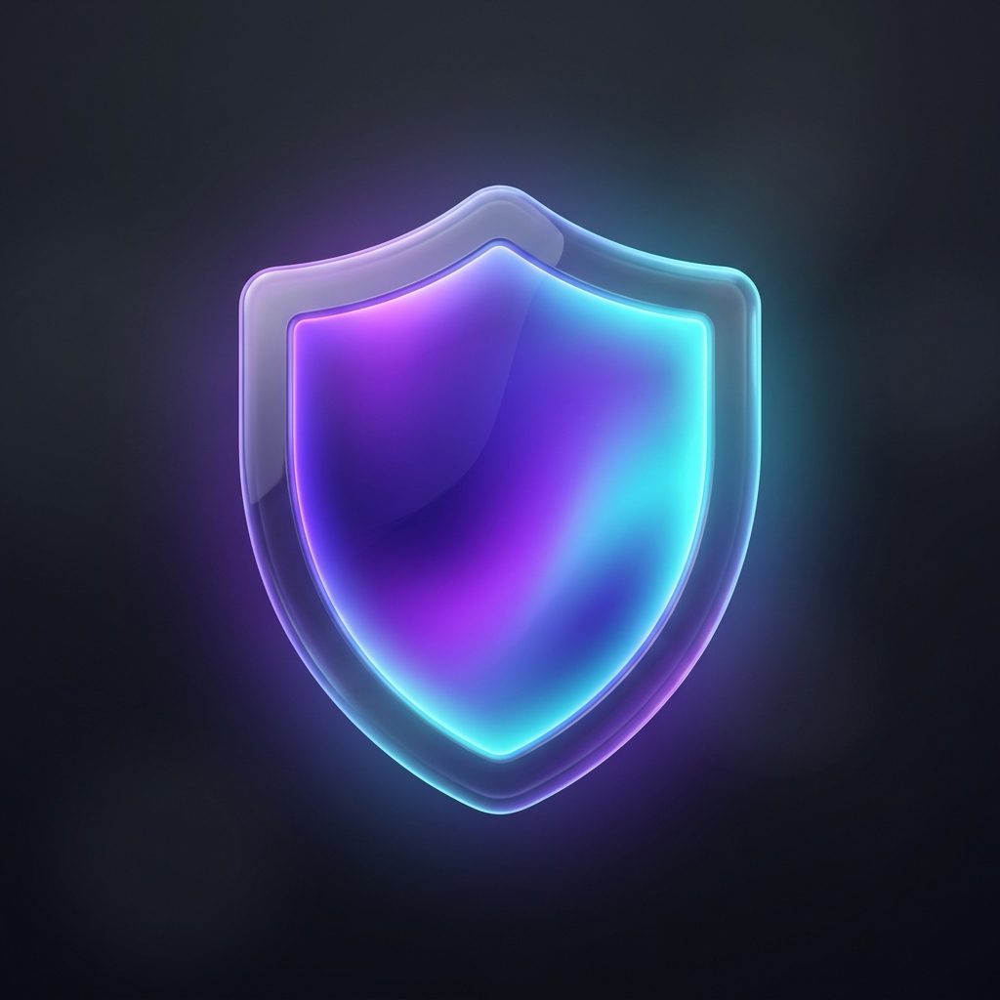

<p align="center">
  
</p>

<h1 align="center">SafeShare (ScreenGuard) 🛡️</h1>

<p align="center">
  <a href="https://github.com/Alhamou/SafeShare/actions"></a>
  <a href="LICENSE"></a>
  <a href="https://apple.com"></a>
  <a href="#privacy--security-guarantee"></a>
</p>

<p align="center">
  <strong>A lightweight, open-source macOS utility that hides confidential apps, instances, and windows during screen sharing in Microsoft Teams, Zoom, and Google Meet.</strong>
</p>

---

## 💡 The Problem

When presenting your desktop in remote meetings, you are forced to choose between two bad options:
1. **Share Entire Screen**: Risk leaking private chats (Slack, WhatsApp), password managers (1Password), email inboxes, or notifications.
2. **Share Single Application Window**: Lose the ability to multitask, demonstrate multi-app workflows, or switch context fluidly.

Because macOS System Integrity Protection (SIP) isolates application processes, no tool can modify another app’s screen capture streams directly.

## 🚀 The SafeShare Solution

SafeShare solves this with a **hardware-filtered desktop preview stream** called **Safe View**:
1. Captures your screen using Apple's official `ScreenCaptureKit` hardware compositor.
2. Dynamically strips out protected applications and private windows in hardware at the Window Server level.
3. Renders the sanitized desktop stream with low latency (<30ms) into a dedicated window: **Safe View**.
4. In your meeting app (**Microsoft Teams**, **Zoom**, or **Google Meet**), you share the **Safe View** window instead of your full screen.
5. You work normally on your real desktop. You see everything; meeting attendees see only what you allow!

```
┌────────────────────────────────────────────────────────┐
│                   macOS Physical Screen                │
│    [Browser (Visible)]   [Slack (Protected)]  [Notes]  │
└────────────────────────────────────────────────────────┘
                            │
               ScreenCaptureKit SCContentFilter
              (Hardware exclusion on GPU level)
                            │
                            ▼
┌────────────────────────────────────────────────────────┐
│              Safe View NSWindow (60/30 FPS)            │
│       [Browser (Visible)]        [Wallpaper/Clean]     │
└────────────────────────────────────────────────────────┘
                            │
         Select "Safe View" window in meeting app
                            │
                            ▼
        Microsoft Teams / Zoom / Google Meet Stream
```

---

## ✨ Features

- **🛡️ Instant Application Protection**: Toggle any running app to protected with one click from the menu bar.
- **🪟 Per-Window & Multi-Instance Control**: Group multi-window apps (like Chrome or Terminal) and set individual windows to `Visible`, `Protected`, or `Inherit`.
- **⚡ Zero-Copy Hardware Acceleration**: Ultra-low CPU usage (<4% on Apple Silicon) powered by `AVSampleBufferDisplayLayer` and Metal.
- **🔒 Fail-Closed Privacy Blanking**: Instantly blanks the stream during screen lock, sleep, or permission transitions to prevent any frame leakage.
- **🖥️ Multi-Display Support**: Choose which physical monitor to capture when using multi-monitor setups.
- **🎛️ Live Stream Quality Tuning**: Switch between 15 FPS (Battery Saver), 30 FPS (Standard), and 60 FPS (Ultra Smooth) dynamically without restarting the stream.
- **🔕 Notification Auto-Hiding**: Automatically prevents macOS Notification Center banners from popping into the stream.
- **🚀 Launch at Login**: Seamless macOS integration via modern `SMAppService.mainApp`.
- **♿ Full Accessibility & Shortcuts**: Built with VoiceOver labels and keyboard shortcuts (`⌘+Shift+S` to toggle stream, `⌘+,` for settings).
- **📶 100% Offline & Private**: Zero network calls, zero analytics, zero disk logging of video frames.

---

## 🛠️ How to Use with Meeting Apps

### Microsoft Teams
1. Open **SafeShare** from your macOS Menu Bar (shield icon).
2. Mark sensitive apps (Slack, Messages, Notes) as **`PROTECTED`**.
3. Click **`Start Safe View`** (or press `⌘ + Shift + S`).
4. In Microsoft Teams, click the **Share** button.
5. Under **Window**, select **`SafeShare — Safe View`**.
6. Present with confidence! Even if you open confidential apps, they will never appear in Teams.

### Zoom
1. Start **Safe View** in SafeShare.
2. In Zoom, click **Share Screen**.
3. In the window list, choose **`SafeShare — Safe View`** and click **Share**.

### Google Meet
1. Start **Safe View** in SafeShare.
2. In Google Meet, click **Present now** → **A window**.
3. Choose **`SafeShare — Safe View`**.

---

## ⌨️ Keyboard Shortcuts

| Shortcut | Action |
| :--- | :--- |
| `⌘ + Shift + S` | Toggle Safe View Stream (Start / Stop) |
| `⌘ + ,` | Open SafeShare Preferences |
| `⌘ + Q` | Quit SafeShare |

---

## 📦 Installation

### Option 1: DMG Installer (Recommended)
Download the latest `SafeShare-1.0.0.dmg` from the [Releases](https://github.com/Alhamou/SafeShare/releases) page, open it, and drag **SafeShare.app** into your `/Applications` folder.

### Option 2: Homebrew Cask
```bash
brew install --cask safeshare
```

### Option 3: Build from Source
Requirements: macOS 14.0+ (Sonoma or Sequoia), Xcode 15+.

```bash
git clone https://github.com/Alhamou/SafeShare.git
cd SafeShare

# Run unit tests
swift test

# Build and package application
./scripts/build_app.sh

# Build DMG installer
./scripts/package_dmg.sh
```

---

## 🔐 Privacy & Security Guarantee

- **Zero Persistence**: No video frames or window titles are ever stored on disk.
- **Zero Telemetry**: No third-party analytics, crash loggers, or external network requests.
- **Standard TCC Permission**: Requires only standard macOS **Screen & System Audio Recording** access. No root privileges or Kernel extensions required.

See [SECURITY.md](SECURITY.md) for detailed privacy policy and architectural guarantees.

---

## 📄 License

SafeShare is open-source software licensed under the [MIT License](LICENSE).
